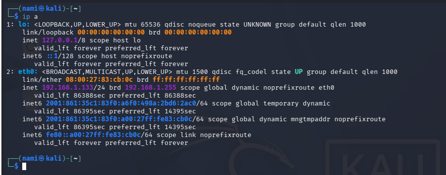
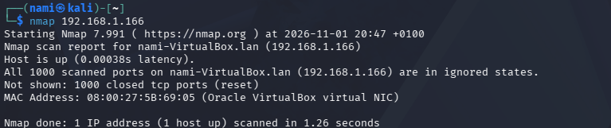

---
layout: post
title: "Mini-lab pentest : nmap, Hydra et fail2ban"
date: 2026-11-02
catégories: pentest lab
---

## Introduction

Dans cet article, je documente la mise en place d'un petit lab de pentest avec deux VM (Kali l'attaquant et Unbutu la cible), connectées en réseau par pont.

Pourquoi ¿ je voulais observer comment se passait une attaque de type force brute autant du côté de l'attaquant que du côté de la cible.

-c'est un peu l'attaque "basique" utilisée, le "dredential sutting" qui consiste à tester en masse des couples d'identifiants/mots de passes issus de fuites préçédentes pour forcer l'accès à d'autres plateformes. De plus en plus de données sont volés avec possibilités d'avoir les logs des personnes, je trouve donc intéressant l'idée d'apprendre le fonctionnement de chacun afin de pouvoir se protéger soi-même ainsi que la famille.
-elle permet d'identifier les failles d'un système et de comprendre à quel point les MAJ (entre autre) sont importantes.
-c'est le précurseur d'incidents beaucoup plus grave alors je voulais d'abord commencer par la base pour ensuite observer le reste :) 
-evaluer l'efficacité des politiques de sécurité, assez intéressant pour sensibiliser dans une entreprise d'avoir plusieurs exemples.
-possibilité de faire une collecte de données sur les listes de mots de passe utilisés pour comprendre les fuites de données internes ou externes en entreprise (à voir plus tard)
-cartographie des sources, enrichir les listes noires de l'entreprise en identifiant la provenance géographique ou les infrastructures réseau utilisés par les attaquants.

CEEEEEEEEEEPEEEEEEEEEEEEEEEENDAAAAAAAAAAAAAAAAAAAANT

J'ai oublié mon mdp Kali :3 donc on va d'abord faire en sorte de le retrouver sinon ça va pas être possib' 

On lance d'abord notre petite Kali, l'écran s'affiche avec 2 choix, appuyez sur "E" afin de passer en édition.
(assets/images/01-ouvrirkali.png)
(assets/images/02-lancerE.png)
Sur la ligne linux, on peut voir un "ro quiet splash"
(assets/images/03-lignelinux.png)
Ro: Read only -> il est montré en lecture seule au début du démarrage donc pas possible de modifier
Quiet: masque les messages textes pendant le démarrage 
Splash : active un affichage graphique animé avec Kali linux.

Cette ligne linux configure donc la manière dont le système démarre.
On va remplacer ces 3 mots par "rw init=/bin/bash
Rw:Read write ça va forcer le système de fichiers à se mettre directement en écriture.
init==/bin/bash : c'est dire au noyau Linux de ne pas lancer le système d'initialisation normal (le login) mais lance un terminal de commance "bash" avec les privilèges les plus élevés : root.
Pourquoi c'est intéréssant ¿ c'est un contournement de sécurité locale de la machine, cela permet d'avoir accès à un terminal et donc taper une commande comme passwd.
 
Le terminal ouvert, il suffira de taper "passwd +  votre nom d'utilisateur" et entrer un nouveau mdp.

Voilà, j'ai de nouveau accès à ma machine! ouf :') 

## Vérifier que les deux  machines communiquent
(assets/images/20-les VM.png)
Une fois mes 2 machines allumées et jointes par un réseau par pont, je lance d'abord "ip a" -> cela permet devoir l'IP des machines.

Une fois que je les ai, je vais lancer un ping sur Kali pour voir si elles communiquent entre elles. Le résultat montre les paquets que Kali envoie à Ubuntu et la réponse de celle-ci.
(assets/images/23-test Ping.png)
Le petit lab est officiellement crée :D *contente* 

## Trouver l'adresse IP de chaque machine 

''' bash

ip a
'''

## 2. Premier scan avec nmap

La prochaine étape est de réaliser des scans depuis Kali pour observer et voir les failles sur Ubuntu. 

'''bash
nmap 192.168.1.166
'''

à ce stade je n'avais aucune faille, j'ai dû installer plusieurs possibilités de faille pour avoir un cas.

## 3. Installer des services pour avoir une cible

J'ai installé SSH, Apache et vsftpd sur Ubuntu pour avoir une vraie surface d'attaque puis relancé le scan.

une fois installé, j'ai relancé le scan et trouver que les ports 21,22 et 80 sont ouverts. pour plus d'infos je lance plusieurs autres actions: 

'''bash
nmap -sV  IP  détecte les versions de service
nmap -sC -sV  IP  + script NSE par défaut
nmap -p- IP tous les 65535 ports
nmap -A IP detection OS + traceroute + scripts 
nmap -sV --script vuln IP recherche de vulnerabilités connues
'''
(assets/images/25-nmap test.png)
(assets/images/26-testnmap.png)
assets/images/27-vulnmap.png)

## 4. Brute-force SSH avec Hydra
J'ai ensuite voulu lancer une attaque classique: sur Kali,je veux utiliser hydra pour travailler sur le SSH (sécure shell: protocole réseau sécurisé qui permet de se connecter à distance à un ordinateur ou un serveur)

sur Ubuntu: sudo adduser testuser avec un mot de mot trèèèèèès basique et simple.
(assets/images/28-creationtestuser.png)
puis sur Kali, j'utilise une wordlist déjà présente et je lance l'attaque avec.
'''bash
hydra -l testuser -P /usr/share/wordlists/rockyou.txt -t 4 ssh://192.168.1.166
'''
(assets/images/29-wordlist.png)

-l un seul login connu qui est testuser, on peut changer en -L users.txt pour faire une recherche de plusieurs logins
-P la liste de mots de passe à tester avec l'emplacement du fichier texte.

## 5. Observation côté défense : fail2ban 

Pendant que l'attaque est lancée, du côté ubuntu je lance

'''bash
sudo tail -f /var/log/auth.log 
'''
et je vois defiler les tentatives échoués. Je décide après le premier échec de l'attaque d'installer fail2ban afin de voir comment cela fonctionne.
(assets/images/31-ubuntusideview.png)
Je peux aussi observer le nombre d'échec et les connexions parralèlles:
(assets/images/34-connexionparraleleactive.png)
(assets/images/33-nombrefail.png) 
Installation sur Ubuntu :
'''bash
sudo apt update fail2ban
'''
(assets/images/31-attaquefail.png)

Fail2ban : fonctionne sur LInux, il repose sur de la surveillance, il analyse en continu les logs de services et repère les comportements suspects. On peut configurer le nombre d'échec acceptés,la durée du ban ect...On peut aussi réaliser des actions comme l'envoi d'une notif sur le tel.
(assets/images/36-laprison.png)
Une fois les "jails" configurées, je relance une attaque Kali et je relance une observation via Ubuntu en même temps; une IP a été bannie suite à trop de tentatives. Yes ça marche ! 
(assets/images/33-nombrefail.png)
Côté Kali, si je tente de relancer une attaque, je reçois un message comme quoi l'IP est bloquée.
(assets/images/37-IPban.png)
(assets/images/39-tentative.png)
(assets/images/40-fail qui fonctionne.png)

ET voilà ! ma première observation d'une attaque force brute sur SSH ! :3 

