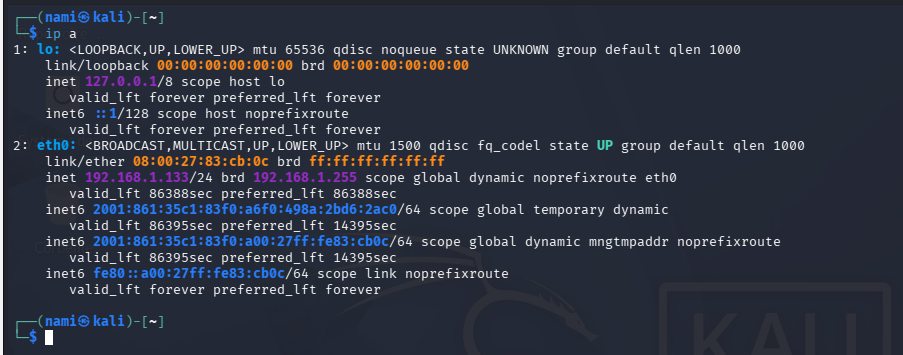
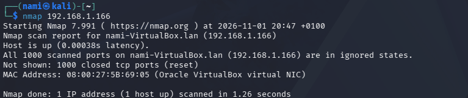

---
layout: post
title: "Mini-lab pentest : nmap, Hydra et fail2ban"
date: 2026-11-02
catégories: pentest lab
---

## Introduction

Dans cet article, je documente la mise en place d'un petit lab de pentest avec deux VM (Kali l'attaquant et Unbutu la cible), connectées en réseau par pont.

## Vérifier que les deux  machines communiquent

Avant tout scan, je m'assure que les deux VM se voient sur le réseau avec un ping; 

## Trouver l'adresse IP de chaque machine 

''' bash

ip a
'''

## 2. Premier scan avec nmap

Une fois la communication confirmée, j'ai lancé un premier scan basique depuis Kali vers Unbutu.
'''bash
nmap 192.168.1.166
'''

A ce stade, tous les ports sont fermés: UNbutu n'exposait encore aucun service.

## 3. Installer des services pour avoir une cible

J'ai installé SSH, Apache et vsftpd sur Ubuntu pour avoir une vraie surface d'attaque puis relancé le scan.

## 4. Brute-force SSH avec Hydra

'''bash
hydra -l testuser -P /usr/share/wordlists/rockyou.txt -t 4 ssh://192.168.1.166
'''
[mémo pour moi: reprendre les screeshots pour hydra]

## 5. Observation côté défense : fail2ban 

Suite aux différentes constatations et observations sur Unbutu, j'ai décidé d'installer fail2ban.
Ce lab m'a permis de comprendre concrètement le cycle attaque/défense; 
